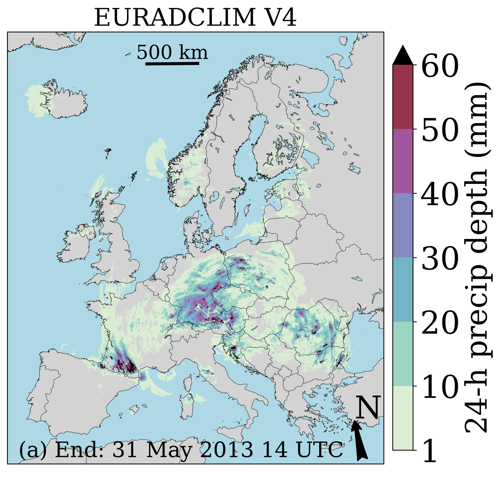
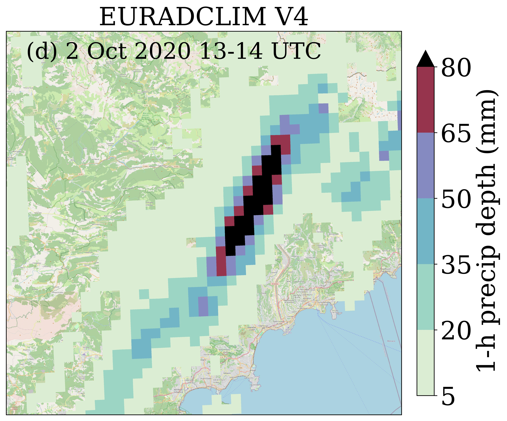

# EURADCLIM-tools: Tools to accumulate and visualize EURADCLIM radar data and to perform climatological analyses.

# Introduction
EURADCLIM (EUropean RADar CLIMatology) is a publicly available climatological dataset of 1-h and 24-h precipitation accumulations on a 2-km grid for the period 2013 through 2025 (version 4). The starting point is the European Meteorological Network (EUMETNET) Operational Program on the Exchange of weather RAdar Information (OPERA) gridded radar dataset of 15-min instantaneous surface rain rates, which is based on data from, on average, 144 ground-based weather radars. After additional removal of non-meteorological echoes by three algorithms, this dataset is merged with precipitation accumulations from potentially ~9600 rain gauges obtained from the European Climate Assessment & Dataset (ECA&D). EURADCLIM covers about 78% of geographical Europe. For an overview of the EURADCLIM project and dataset: https://www.knmi.nl/research/observations-data-technology/projects/euradclim-the-european-climatological-high-resolution-gauge-adjusted-radar-rainfall-dataset.

# Tools
The following tools, written in programming language Python (version 3), are made available in EURADCLIM-tools:
- "AccumulateRadar_netCDF4_CF_Count.py": Script to accumulate netCDF4 CF-1.8 radar precipitation images where the file names are provided as input or to accumulate netCDF4 CF-1.8 radar precipitation images for a given path.
- "ClimatologyRadar_netCDF4_CF": Script to perform climatological analysis on netCDF4 CF-1.8 radar precipitation images where the file names are provided as input or for a given path. The maximum rainfall, mean rainfall, number of events (= frequency) above a threshold value, or number of events above a threshold value divided by the total number of events (= relative frequency) can be computed.
- "Visualize_netCDF4_CF_Cartopy.py": Script to visualize netCDF4 CF-1.8 images (data at a 2-D grid) over Europe.
- "Visualize_netCDF4_CF_CartopyOSM_GM.py": Script to visualize netCDF4 CF-1.8 images (data at a 2-D grid) over Europe. Draws an OpenStreetMap or Google Maps as background. Useful when zooming in on a part of Europe.

Note that EURADCLIM-tools versions up to and including 1.2 work with radar data in ODIM-HDF5 format. For those who work with ODIM-HDF5 files from OPERA, we refer to version 1.2. As of version 2.0, EURADCLIM-tools works with data in netCDF4 CF-1.8 format, and is potentially useful for other than radar precipitation datasets.

# Details
Information on usage of these tools is provided in the respective Python script. The provided tools have been tested with the with the 1-h or 24-h precipitation accumulations from EURADCLIM. Note that all these datasets are in the netCDF4 CF-1.8 format on the default OPERA grid of 2 km resolution (Lambert Azimuthal Equal Area projection; 2200 times 1900 grid cells; but note that the data are sorted differently compared to the ODIM-HDF5 files).

Note that some Python libraries need to be installed for these tools to work, but they are not all needed for every tool: cartopy, copy, matplotlib, natsort, netCDF4, numpy, os, pandas, pyepsg, pyproj, shutil, sys, warnings, xarray.

An advantage with respect to the ODIM-HDF5 files, is that the netCDF CF-1.8 files contain the coordinates of the center of radar grid cells with longitude ("lon") and latitude ()"lat") in degrees (WGS84). This may also be useful for processing the EURADCLIM radar data for analyses and applications or for other visualization tools. Some metadata that was in the ODIM-HDF5 files, is not present in the netCDF4 files, though. Especially the start date and time and the list of employed radars are lacking in the netCDF4 files.


# EURADCLIM datasets
The EURADCLIM datasets of 1-h and 24-h precipitation accumulations become publicly available at the Copernicus Climate Data Store: https://cds.climate.copernicus.eu/. The accompanying scientific article can be found here: https://doi.org/10.5194/essd-15-1441-2023 (version 1 of the dataset).

# Usage - Example for "VisualizeHDF5ODIMCartopy.py"
First obtain the file "RAD_OPERA_24H_RAINFALL_ACCUMULATION_201305311400_v4.nc" from EURADCLIM and then run:
```
python Visualize_netCDF4_CF_Cartopy.py RAD_OPERA_24H_RAINFALL_ACCUMULATION_201305311400_v4.nc RAD_OPERA_24H_RAINFALL_ACCUMULATION_201305311400_EURADCLIM.jpg 'EURADCLIM V4' '24-h precip depth (mm)' CbF '[1,10,20,30,40,50,60]' DrawCountries DrawCoastlines DrawLakelines DoNotColorSetUnder ColorBar '(a) End: 31 May 2013 14 UTC' lightgray lightblue 300 24 29 31 21 NA NA NA DrawNorthArrow DrawScaleBar 'precipitation_amount'
```

Corresponds to Figure 10 in https://doi.org/10.5194/essd-2022-334, but based here on EURADCLIM version 4. Map made with Natural Earth. Free vector and raster map data &copy naturalearthdata.com.

# Usage - Example for "VisualizeHDF5ODIMCartopyOSM_GM.py"
First obtain the file "RAD_OPERA_HOURLY_RAINFALL_ACCUMULATION_202010021400_v4.nc from EURADCLIM and then run:
```
python Visualize_netCDF4_CF_CartopyOSM_GM.py RAD_OPERA_HOURLY_RAINFALL_ACCUMULATION_202010021400_v4.nc RAD_OPERA_HOURLY_RAINFALL_ACCUMULATION_202010021400_EURADCLIM_OSM_France.jpg 'EURADCLIM V4' '1-h precip depth (mm)' CbF '[5,20,35,50,65,80]' NoDrawCountries NoDrawCoastlines DoNotColorSetUnder ColorBar '(d) 2 Oct 2020 13-14 UTC' 600 29 29 29 26 NoDrawParallelsMeridians 'precipitation_amount' OSM street 12 '[6.5,7.5,43.5,44.2]' 1 6.55 44.15
```

Corresponds to Figure 10 in https://doi.org/10.5194/essd-2022-334, but based here on EURADCLIM version 4. &copy OpenStreetMap contributors 2026. Distributed under the Open Data Commons Open Database License (ODbL) v1.0.

Note that by default a class above the highest value of the supplied scale is plotted in the legend and in the figure (this implies that values equal to or exceeding the highest value of the supplied scale belong to this highest class). Note that when "DoColorSetUnder = 'yes'", also a class below the lowest value of the supplied scale is plotted in the legend and in the figure.

# Reference
When referring to EURADCLIM-tools, please check Zenodo and use the citation with doi to the current version (on https://zenodo.org/records/23084686 you can search for the newest version).

Version 4 or higher of the EURADCLIM dataset are available in the Copernicus Climate Data Store: https://cds.climate.copernicus.eu/datasets/insitu-gridded-observations-euradclim?tab=overview ("1-h and 24-h precipitation accumulations for Europe from 2013 to present derived from gauge-adjusted radar observations (EURADCLIM)").


